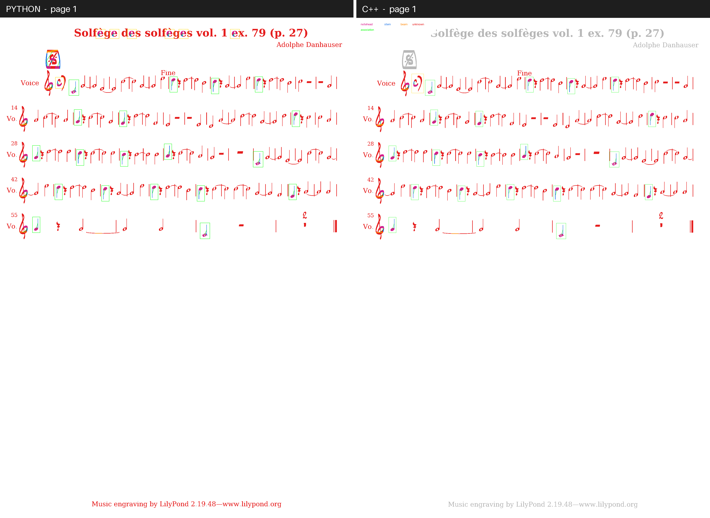
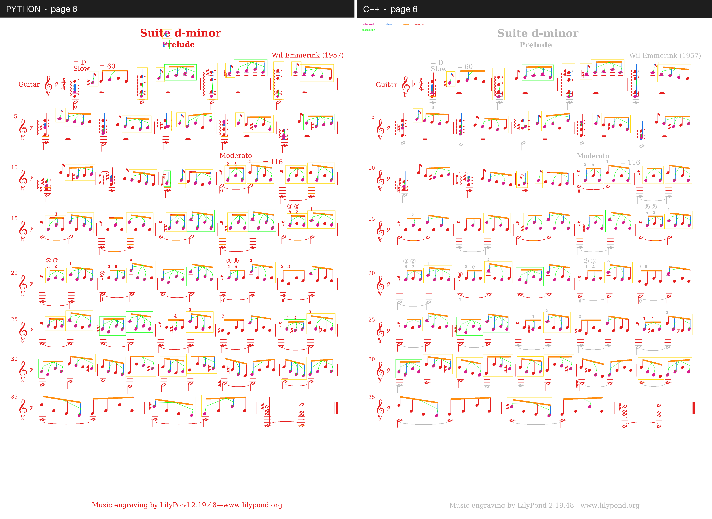
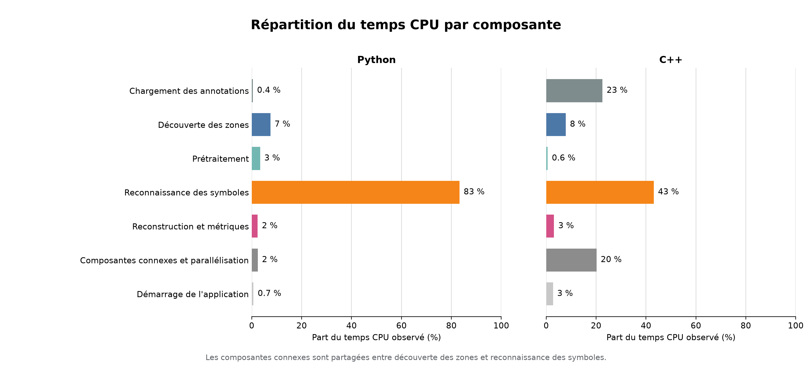

# OMaR

Directional mathematical morphology and graph rewriting rules suffice to transcribe printed musical scores into playable MIDI without a trained classifier. Porting the Python reference pipeline to C++20 cuts end-to-end evaluation time across 10 DeepScoresV2 pages from 205.4 s to 33.4 s (a 6.14x speedup) while keeping symbol detection mAP at 0.514.

OMaR (*Optical Music Recognition*) is a two-language pipeline (Python 3.13 in `prototype/` and C++20 in `cpp/`) evaluated on the [DeepScoresV2](https://zenodo.org/records/4012193) dense subset. We restrict the musical scope to filled quarter notes and beamed eighth notes on treble-clef pages because staff-line removal splits open noteheads into disconnected arcs that destabilize shape descriptors. Four written research reports in French (`reports/`) accompany the codebase and document the state of the art, the evaluation protocol, the morphological and graph methods, and the experimental results.


*Figure 1. Side-by-side primitive segmentation and notation-graph association overlays on DeepScoresV2 page 1 (lilyjazz font) from the Python reference (left) and the C++20 port (right).*

## Pipeline and notation graph

The pipeline converts a raw score page into a format-0 Standard MIDI File (SMF) across four deterministic stages: preprocessing, morphological primitive splitting, notation-graph rewriting, and semantic encoding.

Preprocessing binarizes the page with Sauvola local thresholding (31x31 window, $`k = 0.12`$, computed with integral images in C++), estimates the *staff-space height* from vertical black and white run-length modes, locates staff rows by horizontal projection peak picking, and erases vertical ink runs thinner than twice the staff-line thickness so stems crossing the staff survive. Connected components are then grouped into candidate crops using only pixel geometry and proximity to detected staves.

Each candidate crop is decomposed in fixed order by morphological opening with tailored structuring elements: a rotated line segment extracts beams, a narrow vertical probe extracts stems after beam subtraction, and an elliptical template scan around stem endpoints isolates noteheads. Because we restrict the vocabulary to filled heads, classification into the four target DeepScoresV2 classes (`noteheadBlackOnLine`, `noteheadBlackInSpace`, `stem`, and `beam`) reduces to comparing each notehead centroid against the detected staff rows.

We then assemble a *notation graph* whose nodes are primitives and whose edges (`HEAD_TO_STEM`, `STEM_TO_BEAM`, `ABOVE`, and `ALIGNED_VERTICAL`) encode spatial adjacency. Following Fahmy and Blostein, two graph-rewriting rules run to a fixpoint: a stem linked to one notehead collapses into a `NOTE`, and notes sharing a beam collapse into a `BEAMED_GROUP` (Figure 1). Duration is read from graph structure (isolated notes become quarter notes, beamed groups become eighth notes), pitch is read from the notehead vertical offset in half-staff-spaces, and a custom byte writer serializes the sequence as a monophonic format-0 MIDI file at 480 PPQ and 120 BPM.

## Evaluation and C++20 port

Moving from annotation-seeded crops to *ground-truth-free crop discovery* lowers detection mAP at IoU 0.3 on 10 DeepScoresV2 test pages from 0.645 to 0.515, exposing the recall and precision losses that ground-truth cropping previously hid (Table 1).

In the initial study (`reports/04_results/results.pdf`), crops were seeded from ground-truth bounding boxes to isolate splitter accuracy, which yielded a notehead mask F1 of 0.934, a classification accuracy of 0.931 across 1,969 paired symbols, and a duration Symbol Error Rate (*SER*) of 0.111, although the two runs use different 10-page selections and are not a controlled A/B test. Replacing that shortcut with ground-truth-free crop discovery in both Python and C++20 evaluates the full page without annotation leakage, so missed symbols penalize recall and text or clef fragments penalize precision. DeepScoresV2 annotates stems as 1-pixel-wide boxes, so a 4-pixel detected stem reaches at most 0.25 IoU against its label; we therefore report detection at an IoU threshold of 0.3.

*Table 1. End-to-end benchmark on 10 DeepScoresV2 test pages at IoU 0.3 comparing annotation-seeded crops (Report 4) against ground-truth-free crop discovery in Python and C++20.*

| Metric | Annotation-seeded crops (Python, Report 4) | Ground-truth-free (Python) | Ground-truth-free (C++20) |
|---|---:|---:|---:|
| Total crops discovered | - | 4,941 | 3,108 |
| Useful crops | - | 1,411 | 1,228 |
| Ground-truth coverage | 1.0000 | 1.0000 | 0.9959 |
| Detection mAP @ IoU 0.3 | 0.6445 | 0.5154 | 0.5143 |
| Classification accuracy | 0.9309 | 0.8847 | 0.8777 |
| Graph edge F1 | 0.4001 | 0.3346 | 0.3180 |
| Duration SER | 0.1105 | 0.4175 | 0.3647 |
| Pitch SER | 0.3783 | 0.6039 | 0.5277 |
| Total wall-clock time (10 pages) | - | 205.4 s | 33.4 s |

On the controlled 10-page comparison, the C++20 port discovers 3,108 crops against 4,941 in Python while retaining 0.9959 ground-truth symbol coverage, which lowers duration SER from 0.418 to 0.365 and pitch SER from 0.604 to 0.528 (Figure 2). Symbol recognition and evaluation drop from 182.7 s in Python to 5.5 s in C++20 (a 33.5x speedup on the recognition core), leaving connected-component crop discovery at 28.0 s as the main C++ bottleneck (Figure 3).


*Figure 2. Side-by-side detection and graph reconstruction on DeepScoresV2 page 6 (gutenberg1939 font, 658 ground-truth symbols), where C++20 generates 298 crops against 585 in Python at comparable mAP (0.483 vs 0.518).*


*Figure 3. Share of CPU time spent in each pipeline stage for the Python reference and the C++20 port across the 10-page benchmark.*

## Research reports

Four formal deliverables in French under `reports/` detail the bibliography, metric definitions, algorithmic choices, and ablation tables:

- [Deliverable 1, State of the art (`reports/01_state_of_the_art/state_of_the_art.pdf`)](reports/01_state_of_the_art/state_of_the_art.pdf)
- [Deliverable 2, Evaluation protocol and datasets (`reports/02_evaluation/evaluation.pdf`)](reports/02_evaluation/evaluation.pdf)
- [Deliverable 3, Morphological and graph methods (`reports/03_methods/methods.pdf`)](reports/03_methods/methods.pdf)
- [Deliverable 4, Experimental results and error analysis (`reports/04_results/results.pdf`)](reports/04_results/results.pdf)

## Building and running

### Python reference (`prototype/`)

Requires Python 3.13+ and [uv](https://docs.astral.sh/uv/). The 88-test suite runs without the dataset:

```sh
cd prototype
uv sync
uv run python -m unittest discover -s tests -v
```

### C++20 port (`cpp/`)

Requires CMake 3.20+, a C++20 compiler, OpenCV (`core`, `imgproc`, and `imgcodecs`), and `nlohmann/json`. GoogleTest is fetched automatically by CMake if not installed on the system, and all 101 unit tests run offline:

```sh
brew install opencv nlohmann-json
cmake -S cpp -B cpp/build -DCMAKE_BUILD_TYPE=Release
cmake --build cpp/build -j
ctest --test-dir cpp/build --output-on-failure
```

### End-to-end evaluation on DeepScoresV2

Place the [DeepScoresV2 dense subset](https://zenodo.org/records/4012193) at `prototype/data/ds2_dense/` (or pass another path via `--data`). To run the C++20 evaluator and MIDI exporter:

```sh
./cpp/build/omr_pipeline_eval --split test --limit 10 --iou-threshold 0.3 \
  --data prototype/data/ds2_dense --output output/pipeline_eval

./cpp/build/omr_midi_export --split test --limit 6 \
  --data prototype/data/ds2_dense --output output/midi
```

## Project layout

```text
cpp/        C++20 pipeline, CLI evaluators, and 101 GoogleTest unit tests
prototype/  Python 3.13 reference implementation, benchmarks, and 88 unit tests
public/     Static showcase page and side-by-side comparison figures
reports/    Four LaTeX research deliverables and compiled PDFs
```

## Authors

- Sacha Melin ([@sachaMelin](https://github.com/sachaMelin))
- Abdulkadir Kessaria ([@KadirKess](https://github.com/KadirKess))

## License

Released under the [MIT License](LICENSE).
